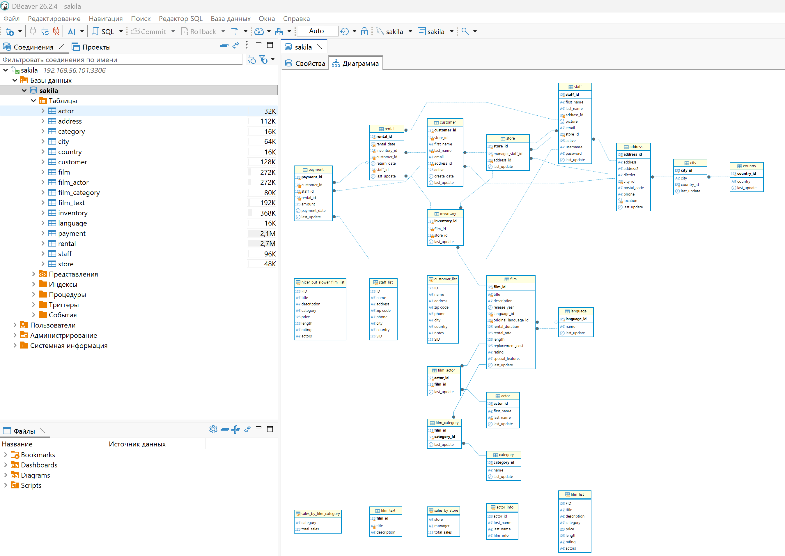

# MySQL — практическая работа
# Антон Сап

**Окружение:** Debian 13 (VirtualBox), Docker, MySQL 8.0.46, DBeaver Community.

## Задание 1. Пользователи, права и восстановление базы

1. Развернул MySQL 8.0 в Docker.
2. Создал пользователя `sys_temp` и предоставил ему права с помощью `GRANT ALL PRIVILEGES`.
3. Проверил пользователей и выданные права через `mysql.user` и `SHOW GRANTS`.
4. Подключился к MySQL от имени `sys_temp`.
5. Восстановил учебную базу **Sakila** из `sakila-schema.sql` и `sakila-data.sql`.
6. Проверил результат: **16 таблиц и 7 представлений (VIEW)**. Построил ER-диаграмму в DBeaver.

**Скриншоты:** [пользователи](mysql-users.jpg) · [выданные права](mysql-user-grants.jpg) · [таблицы Sakila](mysql-sakila-tables.jpg)

**ER-диаграмма Sakila (DBeaver):**



## Задание 2. Первичные ключи

Определил первичные ключи таблиц через `information_schema.KEY_COLUMN_USAGE`.

| Таблица | Первичный ключ |
|---|---|
| `actor` | `actor_id` |
| `address` | `address_id` |
| `category` | `category_id` |
| `city` | `city_id` |
| `country` | `country_id` |
| `customer` | `customer_id` |
| `film` | `film_id` |
| `film_actor` | `actor_id`, `film_id` |
| `film_category` | `film_id`, `category_id` |
| `film_text` | `film_id` |
| `inventory` | `inventory_id` |
| `language` | `language_id` |
| `payment` | `payment_id` |
| `rental` | `rental_id` |
| `staff` | `staff_id` |
| `store` | `store_id` |

В таблицах `film_actor` и `film_category` используются составные первичные ключи.

[Скриншот запроса и результата](myqal-sakila-task2-tables.jpg)

## Задание 3*. Ограничение прав

Отозвал у `sys_temp` глобальные привилегии `INSERT`, `UPDATE`, `DELETE`:

```sql
REVOKE INSERT, UPDATE, DELETE ON *.* FROM 'sys_temp'@'%';
```

Проверил права через `SHOW GRANTS`: `SELECT` остался доступен. Запрос `SELECT` выполнился, а `UPDATE` был отклонён с ошибкой `ERROR 1142`.

**Скриншоты:** [права после REVOKE](mysql-revoke-grants.jpg) · [проверка запрета UPDATE](mysql-permissions-test.jpg)

